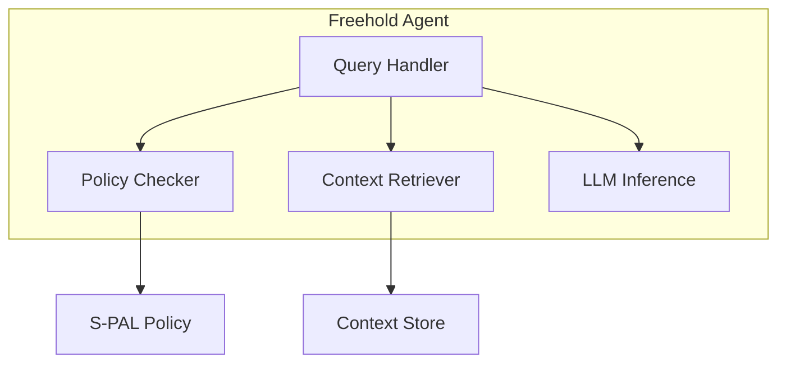

# Freehold Agent

Layer 2: Local AI agent for Personal Context Infrastructure.

## Overview

The Freehold Agent provides:

- **Local AI Processing** - Run language models on your device
- **Context Retrieval** - Query encrypted context store
- **Policy Enforcement** - Validate requests against S-PAL policies
- **Decision Support** - AI-powered assistance without data leakage

## Installation

```bash
# Clone and install
git clone https://github.com/freehold-earth/freehold.git
cd freehold/agent
uv sync

# Optional: the in-process llama-cpp-python loader (single-executable fallback)
uv sync --extra llm
```

## Quick Start

Start a model server, then the agent talks to it at its default address:

```bash
llama-server -m models/Phi-3-mini-4k-instruct-q4.gguf   # http://127.0.0.1:8080
```

```python
from freehold_agent import Agent

# Default configuration: the OpenAI-compatible backend at http://127.0.0.1:8080/v1
agent = Agent()
await agent.initialize()

# Process a request with policy enforcement
response = await agent.process(
    query="What are my upcoming appointments?",
    policy_id="calendar-access",
)

print(response.content)
await agent.close()
```

## Architecture



## Local Inference

Three backends sit behind one protocol. The default is the llama.cpp family
because it makes no outbound calls (ADR-006); the others are selected by
`FREEHOLD_LLM_BACKEND` or `LLMConfig.backend`.

- **`openai`, the default: `llama-server`** from llama.cpp, or any server
  speaking the OpenAI `/chat/completions` protocol (llamafile, vLLM, LM
  Studio). The agent expects it at `http://127.0.0.1:8080/v1`, which is where
  `llama-server` listens out of the box. JSON-schema constrained output goes
  through `response_format`, so the S-PAL flow can synthesise validated
  `RequestContext` proposals on this backend.
- **`ollama`**: a local `ollama serve` daemon (default
  `http://127.0.0.1:11434`). Cross-platform, transparent MLX on Apple
  Silicon, constrained output via Ollama's `format` parameter. Ollama checks
  for updates and ships cloud features that need `OLLAMA_NO_CLOUD=1` to
  disable, which is why it is not the default.
- **`llamacpp`**: the in-process `llama-cpp-python` loader for a GGUF file,
  kept for single-executable demos. Needs the optional `llm` extra
  (`uv sync --extra llm`) and `FREEHOLD_LLM_MODEL_PATH`; it has no
  schema-constrained output, so `propose_request_context` is unavailable on
  it.

Named model tiers (`FREEHOLD_LLM_TIER`), used by both HTTP backends. With
`llama-server` the tier names the model the agent asks for; the server
answers with whichever GGUF file it loaded. Servers that validate model names
(LM Studio, vLLM, llama-server in router mode) reject a tier name they do not
serve, so set `FREEHOLD_OPENAI_MODEL` to the served name for those.

| Tier | Model tag | Notes |
|---|---|---|
| `default` | `qwen3.6:27b` | Primary tier for laptop / dev boxes with 16+ GB. |
| `small` | `phi4-mini:3.8b` | Fallback for <=8 GB RAM boxes. |

freehold-agent targets desktop and server runtimes; the mobile / on-device story lives in a separate native client (see ADR-006 in `docs/decisions`). This release does not expose an `on-device` tier — Bonsai-27B and similar Q1_0 models depend on `llama.cpp` backend support that isn't yet wired into every Ollama build (see [ollama/ollama#15359](https://github.com/ollama/ollama/issues/15359) for tracking).

Basic usage, on the default backend or with Ollama selected explicitly:

```python
from freehold_agent import Agent, AgentConfig, LLMConfig

agent = Agent()  # llama-server at http://127.0.0.1:8080/v1
# agent = Agent(AgentConfig(llm=LLMConfig(backend="ollama", ollama_tier="default")))
await agent.initialize()
try:
    # S-PAL wiring: synthesise a RequestContext for the policy checker
    request_ctx = await agent.propose_request_context(
        "Business wants age >= 18 verification for alcohol purchase."
    )
finally:
    await agent.close()
```

Integration smoke tests against a live server:

```bash
# llama-server (or any OpenAI-compatible server) at FREEHOLD_OPENAI_BASE_URL
uv run pytest -m openai

# Ollama
ollama pull phi4-mini:3.8b
FREEHOLD_OLLAMA_MODEL=phi4-mini:3.8b uv run pytest -m ollama
```

## Docker

`agent/docker-compose.yml` runs the agent with llama-server from the `llm`
profile, serving `MODEL_FILE` out of `MODELS_DIR` (default `./models`):

```bash
COMPOSE_PROFILES=llm docker compose up
```

Without the profile the agent still expects llama-server, so to use Ollama on
the host select it explicitly:

```bash
FREEHOLD_LLM_BACKEND=ollama docker compose up
```

The `infra/` stack has the same shape alongside the other services.

## Reading the context store

The context store is zero-knowledge: it holds entries the user's apps
encrypted with a password that never leaves the browser (AES-256-GCM under a
PBKDF2 key, the format in `context-store/src/crypto`). The agent therefore
decrypts entries itself, and holds no key until it is given one:

```bash
curl -X POST localhost:8082/unlock \
  -H 'Content-Type: application/json' \
  -d '{"user_id": "demo-user", "password": "..."}'   # 204; 401 if wrong; 503 if the store is down
curl -X POST localhost:8082/lock                      # forget it again
curl localhost:8082/health                            # {"vault": "locked" | "unlocked", ...}
```

The password is checked against a stored entry before it is held, and is
held in memory only, for the process. The demo user app sends it after the
user unlocks the vault. Until then approvals resolve as `error` with reason
`private data unavailable`; the cause (locked, unreachable, a field missing)
is logged, not stored on the request, which the business can also read.

What an approval reads is decided by the claim type, not by the business:
`CLAIM_INPUTS` in `services/approval.py` names the scope an `age` claim reads
(`personal/age`, the entries whose key is `personal` or starts with
`personal-` or `personal/`) and the one field it sends to the ZKP service
(`birthDate`). The policy is evaluated against that same scope. Nothing else
in the entries leaves the agent, and an unlisted claim type is denied before
any read.

`ContextClient.search(query, scope, limit)` serves the LLM path: one item per
top-level field of each entry in scope, ranked lexically by the share of query
terms found in the field's name or value, an empty query listing the scope.
Semantic ranking is a later step. Without a scope nothing is read.

## Environment Variables

| Variable | Default | Description |
|----------|---------|-------------|
| `HOST` | `127.0.0.1` | Bind address; loopback by default. The container sets `0.0.0.0` to accept external traffic |
| `PORT` | `8082` | HTTP server port |
| `ZKP_SERVICE_URL` | `http://localhost:8084` | ZKP service endpoint |
| `CONTEXT_STORE_URL` | `http://localhost:8081` | Context store endpoint; the agent decrypts what it reads there (see below) |
| `FREEHOLD_APPROVAL_MODE` | `manual` | Autonomous approval mode: `manual`, `auto_with_notification`, or `fully_autonomous` |
| `CARDANO_API_URL` | `http://localhost:8080` | Cardano devnet API endpoint |
| `FREEHOLD_LLM_BACKEND` | `openai` | `openai` (llama-server or any OpenAI-compatible server), `ollama`, or `llamacpp` (in-process) |
| `FREEHOLD_LLM_TIER` | `default` | `default` (Qwen3.6-27B) or `small` (Phi-4-mini); shared by the HTTP backends |
| `FREEHOLD_OPENAI_BASE_URL` | `http://127.0.0.1:8080/v1` | OpenAI-compatible endpoint, including the `/v1` root. llama-server's own default port; a Cardano devnet on 8080 needs one of them moved |
| `FREEHOLD_OPENAI_MODEL` | _(from tier)_ | Explicit model name; required for servers that validate model names |
| `FREEHOLD_OPENAI_API_KEY` | _(unset)_ | Bearer token, if the server needs one |
| `FREEHOLD_OPENAI_TIMEOUT` | `120.0` | Per-request HTTP timeout (seconds) |
| `FREEHOLD_OLLAMA_URL` | `http://127.0.0.1:11434` | Ollama daemon base URL |
| `FREEHOLD_OLLAMA_MODEL` | _(from tier)_ | Explicit Ollama model tag override |
| `FREEHOLD_OLLAMA_TIMEOUT` | `120.0` | Per-request HTTP timeout (seconds) |
| `FREEHOLD_LLM_MODEL_PATH` | _(unset)_ | GGUF path for the in-process `llamacpp` backend |

## Development

```bash
# Install with dev dependencies
uv sync --group dev

# Run tests
uv run pytest

# Type check
uv run mypy src/

# Lint
uv run ruff check src/

# Run the agent
uv run python -m freehold_agent
```

## Related Packages

- [spec](https://github.com/freehold-earth/freehold/tree/main/spec) - S-PAL schema and protocols
- [context-store](https://github.com/freehold-earth/freehold/tree/main/context-store) - Layer 1: Context Store
- [contracts](https://github.com/freehold-earth/freehold/tree/main/contracts) - Layer 3: Smart Contracts
- [zkp](https://github.com/freehold-earth/freehold/tree/main/zkp) - Layer 4: Zero-Knowledge Proofs
- [identity](https://github.com/freehold-earth/freehold/tree/main/identity) - Layer 5: DID Management

## License

Apache 2.0
