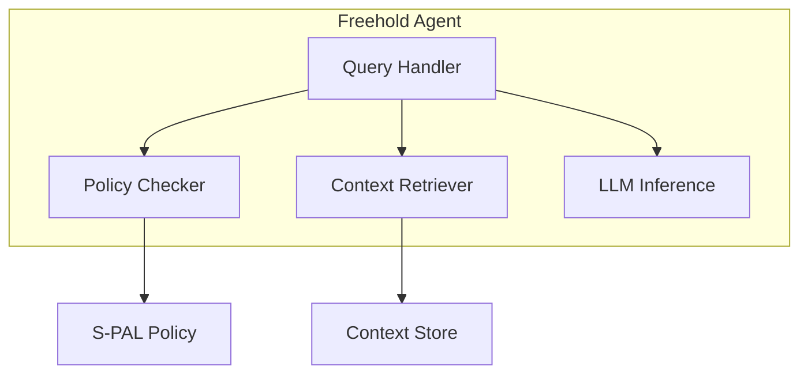

# Freehold Agent

Layer 2: Local AI agent for Personal Context Infrastructure.

## Overview

The Freehold Agent provides:

- **Local AI Processing** - Run language models on your device
- **Context Retrieval** - Query encrypted context store
- **Policy Enforcement** - Validate requests against S-PAL policies
- **Decision Support** - AI-powered assistance without data leakage

## Installation

```bash
# Clone and install
git clone https://github.com/freehold-earth/freehold.git
cd freehold/agent
uv sync

# Optional: the in-process llama-cpp-python loader (single-executable fallback)
uv sync --extra llm
```

## Quick Start

Every link the agent has is TLS: to the model server, the context store and
the ZKP service, and its own API. One certificate authority covers the lot.
`infra/scripts/certs.sh` writes it and a certificate per service (the `infra/`
stack's `setup.sh` calls it the same way); start a model server with its
certificate and tell the agent what to trust:

```bash
../infra/scripts/certs.sh certs llama-server agent   # certs/ca.crt and certs/<name>.{key,crt}
llama-server -m models/Phi-3-mini-4k-instruct-q4.gguf \
  --ssl-key-file certs/llama-server.key --ssl-cert-file certs/llama-server.crt   # https://127.0.0.1:8080
export FREEHOLD_CA_FILE=$PWD/certs/ca.crt
```

To serve the coordination API, give it the agent's certificate; it is never
served in cleartext:

```bash
FREEHOLD_TLS_CERT_FILE=$PWD/certs/agent.crt FREEHOLD_TLS_KEY_FILE=$PWD/certs/agent.key \
  uv run python -m freehold_agent                      # https://127.0.0.1:8082
```

```python
from freehold_agent import Agent, AgentConfig

# The settings above, read from the environment; Agent() alone uses the
# built-in defaults and reads nothing.
agent = Agent(AgentConfig.from_env())
await agent.initialize()

# Process a request with policy enforcement
response = await agent.process(
    query="What are my upcoming appointments?",
    policy_id="calendar-access",
)

print(response.content)
await agent.close()
```

## Architecture



## Local Inference

Three backends sit behind one protocol. The default is the llama.cpp family
because it makes no outbound calls (ADR-006); the others are selected by
`FREEHOLD_LLM_BACKEND` or `LLMConfig.backend`. One set of settings serves all
three: `FREEHOLD_LLM_URL`, `FREEHOLD_LLM_MODEL`, `FREEHOLD_LLM_TIER`,
`FREEHOLD_LLM_API_KEY` and `FREEHOLD_LLM_TIMEOUT`.

The model server's address is always `https://`, like every address the
agent is given. Prompts, released context and the bearer token travel over
that link, so the agent refuses a plain `http://` address wherever it points,
loopback included; a certificate is cheap and the `infra/` stack generates
one. A server with a certificate of its own is trusted through
`FREEHOLD_CA_FILE`, the one file the agent trusts beside the system store on
every link.

- **`http`, the default: `llama-server`** from llama.cpp, or any server
  speaking the chat-completions protocol (llamafile, vLLM, LM Studio). The
  agent expects it at `https://127.0.0.1:8080/v1`, llama-server's own port
  with the TLS the stack gives it. The `infra/` stack starts it with a 2.3 GB
  Phi-3-mini so it fits any box; the tiers below are what the agent asks for
  by name. JSON-schema constrained output goes through `response_format`, so
  the S-PAL flow can synthesise validated `RequestContext` proposals on this
  backend.
- **`ollama`**: a local `ollama serve` daemon behind a TLS proxy, since
  Ollama serves plain HTTP only; `FREEHOLD_LLM_URL` is the proxy's address
  and has no default. Cross-platform, transparent MLX on Apple Silicon,
  constrained output via Ollama's `format` parameter. Ollama checks for
  updates and ships cloud features that need `OLLAMA_NO_CLOUD=1` to disable,
  which is why it is not the default.
- **`llamacpp`**: the in-process `llama-cpp-python` loader for a GGUF file,
  kept for single-executable demos. Needs the optional `llm` extra
  (`uv sync --extra llm`), with `FREEHOLD_LLM_MODEL` naming the file; it has
  no schema-constrained output, so `propose_request_context` is unavailable
  on it.

Named model tiers (`FREEHOLD_LLM_TIER`), used by both HTTP backends. With
`llama-server` the tier names the model the agent asks for; the server
answers with whichever GGUF file it loaded. Servers that validate model names
(LM Studio, vLLM, llama-server in router mode) reject a tier name they do not
serve, so set `FREEHOLD_LLM_MODEL` to the served name for those.

| Tier | Model tag | Notes |
|---|---|---|
| `default` | `qwen3.6:27b` | Primary tier. The weights are about 17 GB at Q4; the KV cache, the OS and the agent make up the rest, so it needs 24 GB or more, 32 GB with room to spare (ADR-004). |
| `small` | `phi4-mini:3.8b` | Fallback for <=8 GB RAM boxes. |

freehold-agent targets desktop and server runtimes; the mobile / on-device story lives in a separate native client (see ADR-006 in `docs/decisions`). This release does not expose an `on-device` tier — Bonsai-27B and similar Q1_0 models depend on `llama.cpp` backend support that isn't yet wired into every Ollama build (see [ollama/ollama#15359](https://github.com/ollama/ollama/issues/15359) for tracking).

Basic usage, on the default backend or with Ollama selected explicitly:

```python
from freehold_agent import Agent, AgentConfig, LLMConfig

agent = Agent(AgentConfig.from_env())  # or Agent() for the built-in defaults
# agent = Agent(AgentConfig(llm=LLMConfig(backend="ollama", url="https://127.0.0.1:11434")))
await agent.initialize()
try:
    # S-PAL wiring: synthesise a RequestContext for the policy checker
    request_ctx = await agent.propose_request_context(
        "Business wants age >= 18 verification for alcohol purchase."
    )
finally:
    await agent.close()
```

Integration smoke tests against a live server:

```bash
# llama-server (or any chat-completions server) at FREEHOLD_LLM_URL;
# the model is a name the server serves
FREEHOLD_LLM_MODEL=qwen3.6:27b uv run pytest -m openai

# Ollama behind a TLS proxy at FREEHOLD_LLM_URL
ollama pull phi4-mini:3.8b
FREEHOLD_LLM_URL=https://localhost:11435 FREEHOLD_LLM_MODEL=phi4-mini:3.8b uv run pytest -m ollama
```

## Docker

The `infra/` stack runs the agent with llama-server from the `llm` profile,
serving `MODEL_FILE` out of `MODELS_DIR`, over the certificate and API key
`infra/scripts/setup.sh` generates:

```bash
cd ../infra && ./scripts/setup.sh && docker compose up
```

See `infra/README.md` for the settings, and for running against Ollama on the
host behind a TLS proxy instead. The browser apps are the demo stack's; its
README says which certificates they need.

## Reading the context store

The context store is zero-knowledge: it holds entries the user's apps
encrypted with the user's password (AES-256-GCM under a PBKDF2 key, the
format in `context-store/src/crypto`), and the store itself never sees that
password. The agent decrypts entries itself, and holds no key until the user
gives it the password:

```bash
curl --cacert certs/ca.crt -X POST https://localhost:8082/unlock \
  -H 'Content-Type: application/json' \
  -d '{"user_id": "demo-user", "password": "..."}'   # 204; 401 if wrong; 503 if the store is down
curl --cacert certs/ca.crt -X POST https://localhost:8082/lock                      # forget it again
curl --cacert certs/ca.crt https://localhost:8082/health                            # {"vault": "locked" | "unlocked", ...}
```

The password is checked against a stored entry before it is held, and is
held in memory only, for the process; a failed attempt makes the next one
wait (0.5 s doubling to 8 s). The password is accepted if it opens any
vault-format entry, and an entry it does not open is skipped with a warning
when a scope is read, so one stray entry neither locks the user out nor
blocks its domain. `/unlock` and `/lock` refuse a browser origin outside
`FREEHOLD_CORS_ORIGINS` outright (403), since CORS alone would still let the
request run. Approving a request tied to a service request checks that the
unlocked vault is that service request's user's. The demo user app sends it after the
user unlocks the vault. Like the rest of the coordination API in this phase,
`/unlock` and `/lock` are unauthenticated and the agent binds loopback by
default; they are for a local agent reached from the user's own apps, not
for exposure beyond the machine. Until then approvals resolve as `error` with reason
`private data unavailable`; the cause (locked, unreachable, a field missing)
is logged, not stored on the request, which the business can also read.

A human approval that names an ephemeral DID is accepted only with the
holder's signature over the request (`spal/did-approval/v1`) and a record in
the unlocked vault that the vault's root issued that DID: the agent reads the
`root-identity` entry and the `identity` scope (the user app keeps records
under `identity/authorizations/`), rebuilds the record's canonical
`spal/did-authorization/v2` preimage with `freehold_preimage` and verifies
the root signature with the key the vault holds (`authorization.py`). The
approval says where the record is (`record_key`), so the check is two
reads and the vault is never searched. A DID without such a record is
refused (403), a locked vault cannot vouch and answers 409, an unreachable
store 503; in each case the request stays pending for a retry. The record
never leaves the vault.

What an approval reads is decided by the claim type, not by the business:
`CLAIM_INPUTS` in `services/approval.py` names the scope an `age` claim reads
(`personal/age`, the entries whose key is `personal` or starts with
`personal-` or `personal/`) and the one field it sends to the ZKP service
(`birthDate`). The policy is evaluated against that same scope. Nothing else
in the entries leaves the agent, and an unlisted claim type is denied before
any read.

`ContextClient.search(query, scope, limit)` serves the LLM path: one item per
top-level field of each entry in scope, ranked lexically by the share of query
terms found in the field's name or value, an empty query listing the scope.
Semantic ranking is a later step. Without a scope nothing is read.

## Environment Variables

| Variable | Default | Description |
|----------|---------|-------------|
| `FREEHOLD_HOST` | `127.0.0.1` | Bind address; loopback by default. The container sets `0.0.0.0` to accept external traffic |
| `FREEHOLD_PORT` | `8082` | API port. Bare `HOST` and `PORT`, which shells and platforms set for their own reasons, are not read |
| `FREEHOLD_TLS_CERT_FILE` | _(unset)_ | The certificate the API serves; with `FREEHOLD_TLS_KEY_FILE`, required to serve it. The API is never served in cleartext |
| `FREEHOLD_TLS_KEY_FILE` | _(unset)_ | The key for that certificate |
| `FREEHOLD_CA_FILE` | _(unset)_ | A certificate (or bundle) trusted beside the system store on every link, such as the stack's `ca.crt` |
| `FREEHOLD_CONTEXT_STORE_URL` | `https://localhost:8081` | Context store endpoint, `https://` only; the agent decrypts what it reads there (see below) |
| `FREEHOLD_ZKP_URL` | `https://localhost:8084` | ZKP service endpoint, `https://` only |
| `FREEHOLD_CARDANO_URL` | `https://localhost:8080` | Cardano API endpoint, `https://` only; a plain-HTTP devnet API goes behind a TLS proxy, as the `infra/` stack does |
| `FREEHOLD_CORS_ORIGINS` | the demo apps' origins (`https://localhost:4501`, `4502`, `3000`, `3001`) | Comma-separated browser origins allowed to call the API, `https://` only; never a wildcard |
| `FREEHOLD_APPROVAL_MODE` | `manual` | Autonomous approval mode: `manual`, `auto_with_notification`, or `fully_autonomous` |
| `FREEHOLD_LLM_BACKEND` | `http` | `http` (llama-server or any chat-completions server), `ollama`, or `llamacpp` (in-process) |
| `FREEHOLD_LLM_URL` | `https://127.0.0.1:8080/v1` | The model server, `https://` only, including the `/v1` root for the `http` backend. No default for `ollama`: it is the TLS proxy's address |
| `FREEHOLD_LLM_MODEL` | _(from tier)_ | Model name or tag the HTTP backends ask for, or the GGUF path the in-process loader opens |
| `FREEHOLD_LLM_TIER` | `default` | `default` (Qwen3.6-27B) or `small` (Phi-4-mini); the model asked for when `FREEHOLD_LLM_MODEL` is unset |
| `FREEHOLD_LLM_API_KEY` | _(unset)_ | Bearer token, if the server needs one |
| `FREEHOLD_LLM_TIMEOUT` | `120.0` | Per-request HTTP timeout (seconds) |

## Development

```bash
# Install with dev dependencies
uv sync --group dev

# Run tests
uv run pytest

# Type check
uv run mypy src/

# Lint
uv run ruff check src/

# Run the agent
uv run python -m freehold_agent
```

## Related Packages

- [spec](https://github.com/freehold-earth/freehold/tree/main/spec) - S-PAL schema and protocols
- [context-store](https://github.com/freehold-earth/freehold/tree/main/context-store) - Layer 1: Context Store
- [contracts](https://github.com/freehold-earth/freehold/tree/main/contracts) - Layer 3: Smart Contracts
- [zkp](https://github.com/freehold-earth/freehold/tree/main/zkp) - Layer 4: Zero-Knowledge Proofs
- [identity](https://github.com/freehold-earth/freehold/tree/main/identity) - Layer 5: DID Management

## License

Apache 2.0
