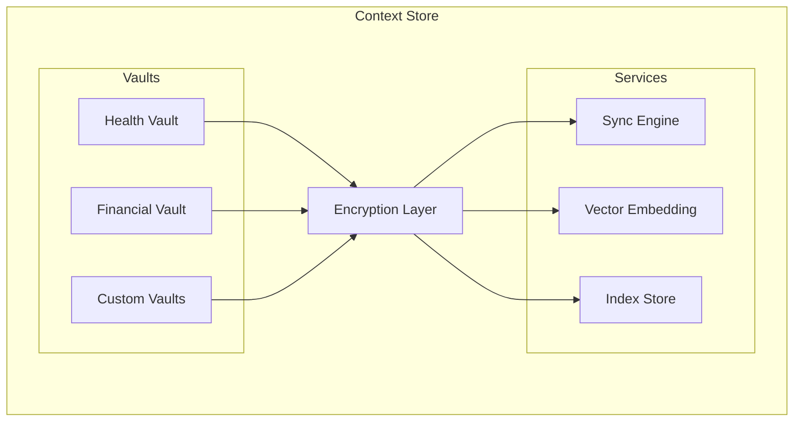

# Freehold Context Store

Layer 1: Encrypted local-first data storage with CRDT sync for Personal Context Infrastructure.

## Overview

The Context Store provides:

- **Encrypted Vaults** - AES-256-GCM encryption at rest
- **CRDT Sync** - Conflict-free replication across devices
- **Vector Embeddings** - Semantic search over personal context
- **Local-First** - Data stays on your devices

## Installation

```bash
pnpm add @freehold-earth/context-store
```

## Quick Start

```typescript
import { ContextStore, Vault } from "@freehold-earth/context-store"

// Initialize the context store
const store = new ContextStore({
  encryption: {
    algorithm: "aes-256-gcm",
  },
})

// Create a vault for health data
const healthVault = await store.createVault("health")

// Store encrypted data
await healthVault.put("allergies", {
  items: ["penicillin", "peanuts"],
  lastUpdated: new Date(),
})

// Retrieve and decrypt
const allergies = await healthVault.get("allergies")
```

## Architecture



## Storage Options

### In-Memory (default)
```typescript
const vault = new EncryptedVault({
  name: "my-vault",
  storage: { type: "memory" },
})
```

### SQLite Persistence
```typescript
const vault = new EncryptedVault({
  name: "my-vault",
  storage: {
    type: "sqlite",
    path: "./data/my-vault.db"
  },
})
```

## Sync Rooms

Peers sync through a y-websocket server and only see each other inside the same room. Every device of one vault sets the same `room` in its `SyncConfig`; distinct vaults on a shared server set distinct rooms, because vaults sharing a room merge their entries. There is no default room: a realtime `SyncConfig` with `peers` and no `room` is rejected, as is `addPeer` on a realtime vault without one, so two vaults never share a room by accident. Only realtime mode contacts peers.

```typescript
const vault = new SyncedVault({
  name: "health",
  sync: { mode: "realtime", peers: ["wss://sync.example"], room: "health-7f3a" },
})
```

Release 0.2.0 joined `pci-vault` and had no `room` option; release 0.3.0 joined `freehold-vault` when `room` was unset. A device on this version meets those only by naming their room: pass `room: "pci-vault"` or `room: "freehold-vault"` until the last device of the vault has upgraded, then move every device to a room of its own together.

## Semantic Search

Use `SemanticIndex` with `TransformersEmbedder` for local text search. The
embedding model runs in-process via ONNX; weights are downloaded once into a
local cache, and inference never leaves the machine.

```typescript
import { SemanticIndex, TransformersEmbedder } from "@freehold-earth/context-store"

const embedder = new TransformersEmbedder() // all-MiniLM-L6-v2, 384 dims
const index = new SemanticIndex(embedder, { path: "./data/index.db" })

// Index text with optional metadata
await index.index("doc1", "My cat loves sleeping in the sun", { source: "notes" })

// Query by meaning, not keywords
const results = await index.query("what do felines enjoy doing", 10)
```

`TransformersEmbedder` accepts a different `model`, `revision`, `dtype`,
`cacheDir`, `localFilesOnly` (strict offline mode), and
`queryPrefix`/`documentPrefix` for models trained with task prefixes (e.g.
EmbeddingGemma). When changing model, set `dimensions` to match its output.

Every embedder exposes a `fingerprint` describing the vector space it produces
(model, revision, dtype, dimensions, pooling and prefixes). `SemanticIndex`
records it when a database is created and refuses to open that database with
an embedder whose fingerprint differs, so vectors from two models are never
mixed and queried as if comparable. To switch models, build a new index file.

## Vector Search

Use `SQLiteVectorStore` directly when you already have pre-computed embeddings:

```typescript
import { SQLiteVectorStore } from "@freehold-earth/context-store"

const vectorStore = new SQLiteVectorStore({
  path: ":memory:",
  dimensions: 384,  // e.g., all-MiniLM-L6-v2
  distanceMetric: "cosine",
})

// Add embeddings
await vectorStore.add("doc1", embedding, { source: "notes" })

// Search for similar
const results = await vectorStore.search(queryEmbedding, 10)
```

## Running the server

The store is served over TLS or not at all: the vault password crosses the
link on every unlock. `TLS_CERT_FILE` and `TLS_KEY_FILE` name its certificate
and key, and the server refuses to start without them. The `infra/` stack's
`certs.sh` writes a CA and a certificate per service; clients trust the CA.

```bash
../infra/scripts/certs.sh certs context-store      # certs/ca.crt, certs/context-store.{key,crt}
pnpm build
TLS_CERT_FILE=certs/context-store.crt TLS_KEY_FILE=certs/context-store.key node dist/server.js
curl --cacert certs/ca.crt https://localhost:8081/health
```

`PORT` (default `8081`), `BIND_ADDRESS` (default `127.0.0.1`; a container sets `0.0.0.0`) and `DATA_DIR` (default `./data`) are the other settings.

## Development

```bash
# Install dependencies
pnpm install

# Run tests
pnpm test

# Build
pnpm build

# Type check
pnpm lint
```

## Related Packages

- [spec](https://github.com/freehold-earth/freehold/tree/main/spec) - S-PAL schema and protocols
- [agent](https://github.com/freehold-earth/freehold/tree/main/agent) - Layer 2: Personal Agent
- [contracts](https://github.com/freehold-earth/freehold/tree/main/contracts) - Layer 3: Smart Contracts
- [zkp](https://github.com/freehold-earth/freehold/tree/main/zkp) - Layer 4: Zero-Knowledge Proofs
- [identity](https://github.com/freehold-earth/freehold/tree/main/identity) - Layer 5: Identity (DIDs)

## License

Apache 2.0
