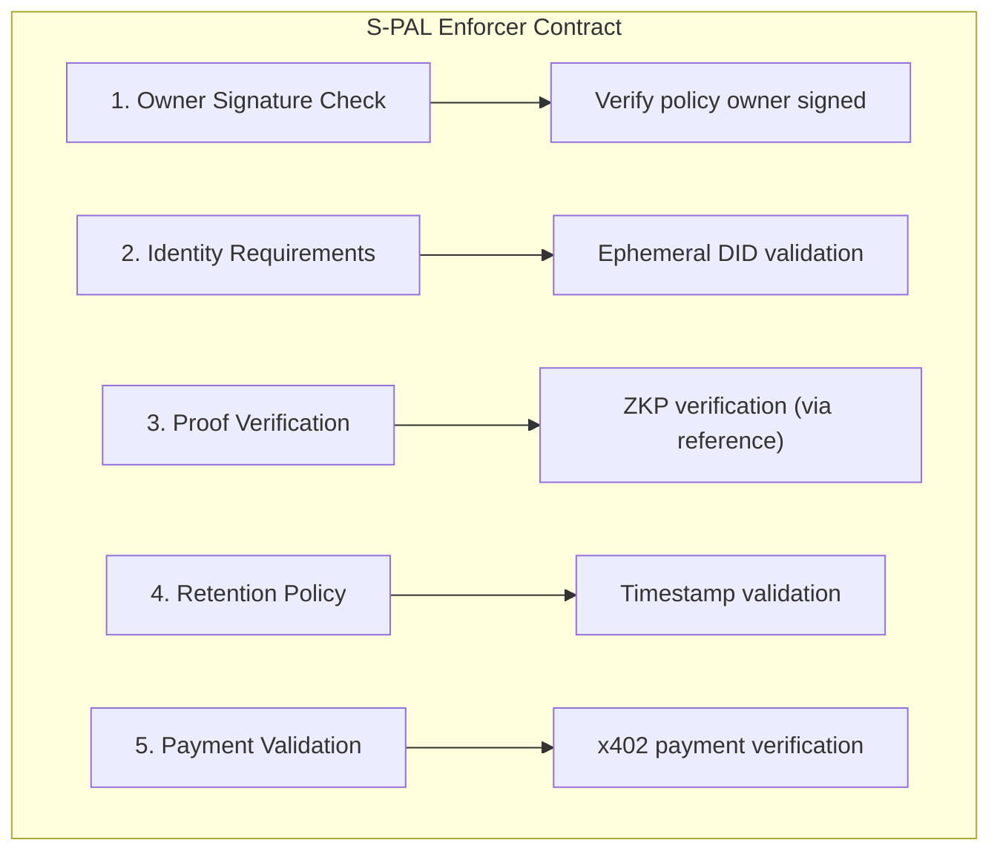

# Freehold Contracts

Layer 3: Cardano smart contracts for S-PAL policy enforcement using Aiken.

## Overview

Freehold Contracts provides:

- **S-PAL Enforcement** - Cryptographic enforcement of privacy policies
- **Policy Validation** - On-chain validation of access rules
- **Identity Verification** - DID-based identity checks
- **Payment Handling** - Micropayment validation for x402

## Installation

```bash
pnpm add @freehold-earth/contracts
```

## Quick Start

```typescript
import {
  SPALEnforcer,
  SPALPolicy,
  ValidationRequest,
  compileValidator,
} from "@freehold-earth/contracts";

// Compile the validator
const compiled = await compileValidator();

// Create an enforcer instance
const enforcer = new SPALEnforcer(compiled);

// Validate a policy interaction: the policy and the request are separate
// objects (field docs in src/types.ts)
const policy: SPALPolicy = {
  id: "spal:did:key:z6Mkowner123:health-records",
  ownerPkh: "<owner payment key hash, hex>",
  minPayment: 0n,
  maxRetentionMs: 86_400_000,
  identityLinkage: {
    ephemeralRequired: true,
    proofOfRootAllowed: true,
    zkContinuityAllowed: false,
  },
  requiredProofHash: "",
  contextScope: "medical/allergies",
  paymentCurrency: { kind: "Ada" },
};
const request: ValidationRequest = {
  policyId: policy.id,
  requesterDid: "did:key:z6Mkabc",
  proofCommitment: "",
  accessTime: Date.now(),
  paymentAmount: 0n,
};
const result = await enforcer.validate(policy, request);
```

## Architecture

The S-PAL Enforcer contract validates:



## Contract Language

Contracts are written in Aiken, a functional language for Cardano:

```aiken
// Example S-PAL validator in Aiken
validator spal {
  spend(
    datum: Option<PolicyDatum>,
    redeemer: AccessRedeemer,
    _utxo: OutputReference,
    tx: Transaction,
  ) {
    when datum is {
      Some(policy) -> {
        let owner_signed = check_owner_signature(tx, policy.owner)
        let ephemeral_valid = check_ephemeral_did(
          redeemer.requester_did,
          policy.requires_ephemeral_did,
        )
        owner_signed && ephemeral_valid
      }
      None -> False
    }
  }
}
```

## Development

### Prerequisites

1. **Aiken** - Cardano smart contract language
2. **Docker** and **Docker Compose** (for local Cardano devnet)
3. **Node.js 18+** and **pnpm** (for TypeScript SDK)

### Install Aiken

```bash
# Install via aikup (recommended)
curl --proto '=https' --tlsv1.2 -LsSf https://install.aiken-lang.org | sh
source ~/.aiken/bin/env
aikup

# Verify installation
aiken --version
```

### Run Local Cardano Devnet (Yaci DevKit)

The devnet runs what mainnet runs: protocol version 11 with mainnet's Plutus
cost models, behind Ogmios 7 and Kupo 2.12. `docker-compose.yml` pins the
image and the mode that makes that so.

```bash
docker compose up -d      # or: make dev
docker compose down -v    # stop and discard the chain

# This provides:
# - Ogmios (localhost:1337) and Kupo (localhost:1442), which the SDK uses
# - Yaci Store API (localhost:8080)
# - Devnet admin API with a faucet (localhost:10000)
# - Submit API (localhost:8090), node-to-node port (localhost:3001)
```

### Run the On-Chain Tests

With the devnet up and the contract built (`aiken build` in
`spal_validator/`):

```bash
pnpm test:integration
```

These connect through the SDK's own start-up path, fund a test wallet from
the devnet's faucet, create a policy UTxO, and spend it through the
validator, so the node accepts the last transaction only if the Aiken script
does. They skip when no devnet is running; with `FREEHOLD_LIVE_REQUIRED=1`
a missing devnet is a failure instead, which is how CI runs them. CI runs them
on any pull request that touches `contracts/` or the lockfile
(`.github/workflows/live-cardano.yml`).

### Build and Test Contracts

```bash
# Navigate to Aiken project
cd spal_validator

# Check contract syntax
aiken check

# Build contract (generates Plutus script)
aiken build

# Run tests
aiken check  # includes test execution

# View generated blueprint
cat plutus.json
```

### Build TypeScript SDK

```bash
# Install dependencies
pnpm install

# Compile contracts
pnpm compile

# Run tests
pnpm test

# Build for distribution
pnpm build
```

### Verify Cardano Devnet is Running

```bash
# Check blocks are being produced
curl http://localhost:8080/api/v1/blocks

# Check node sync status
curl http://localhost:8080/api/v1/epochs/latest
```

## Related Packages

- [spec](https://github.com/freehold-earth/freehold/tree/main/spec) - S-PAL schema and protocols
- [context-store](https://github.com/freehold-earth/freehold/tree/main/context-store) - Layer 1: Context Store
- [freehold-agent](https://github.com/freehold-earth/freehold/tree/main/agent) - Layer 2: Personal Agent
- [zkp](https://github.com/freehold-earth/freehold/tree/main/zkp) - Layer 4: Zero-Knowledge Proofs
- [identity](https://github.com/freehold-earth/freehold/tree/main/identity) - Layer 5: Identity (DIDs)

## License

Apache 2.0
