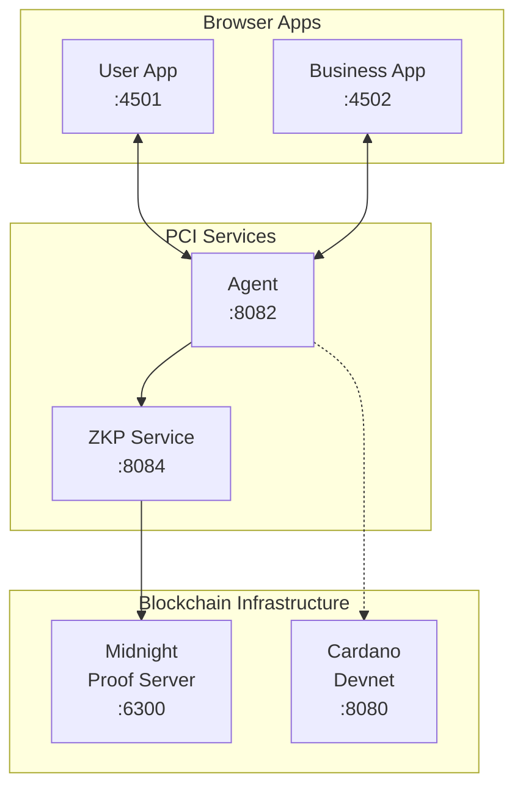

# PCI Demo

Interactive demonstration of Personal Context Infrastructure (PCI) showing privacy-preserving data sharing between users and businesses using zero-knowledge proofs.

## Overview

This demo showcases:

- **User App** - Request services, approve/deny verification requests, manage personal context
- **Business App** - Receive service requests, verify customer information without accessing raw data
- **Age Verification Flow** - Prove "user is >= 21" without revealing actual birth date

## Architecture



## Request Flow

The default flow starts in the User App with a service request; the Business
App responds with a verification requirement and completes the request once
verified:

```mermaid
sequenceDiagram
    participant U as User App
    participant A as Agent
    participant B as Business App
    participant Z as ZKP Service
    participant M as Midnight

    U->>A: POST /service-requests<br/>(e.g. "Purchase Alcohol",<br/>policy_name: which of the holder's<br/>policies it is made under)
    A->>A: Read the policy from the<br/>unlocked vault; attach its terms<br/>and terms hash (never its id)
    B->>A: GET /service-requests<br/>(polling)
    A-->>B: Pending service request<br/>with the holder's terms
    B->>A: POST /requests<br/>(verify age >= 21, terms_hash:<br/>the terms it accepts,<br/>linked via service_request_id)
    U->>A: GET /requests<br/>(polling)
    A-->>U: Verification request
    U->>A: POST /requests/:id/approve<br/>(body: the ephemeral DID the proof is for,<br/>signed by its key over this request;<br/>private data comes from the context<br/>store, not the body)
    A->>A: Resolve terms_hash to the stored<br/>policy; its rule for personal/age<br/>decides (403 to the holder if not)
    A->>Z: Generate ZK proof
    Z->>M: Midnight proof generation
    M-->>Z: ZK proof
    Z-->>A: Proof result
    A-->>U: Approved with proof<br/>(response echoes terms_hash)
    B->>A: GET /service-requests<br/>(polling)
    A-->>B: Verified (ageOver: 21)
    B->>A: POST /service-requests/:id/complete
    A-->>B: Completed
```

Every decision runs against the holder's own S-PAL policy, kept encrypted in
their vault under `policies/{name}` (the user app seeds one, "Age
Verification Only", under `policies/age-verification` on first unlock). A
business never sees the policy's id or owner, which would carry the
holder's root DID: it sees the policy's **terms** on the service request
and accepts them by sending back their hash
(`spec/protocols/policy-terms.md`). The approve button consults the policy
too: a human's click is consent within the holder's standing rule, and a
403 on approve tells the holder which check failed, while the business
sees only `not permitted by the holder's policy`.

The approval call's body is optional and carries only `requester_did`, the
ephemeral DID the proof is for, with `signature`, that DID's key's signature
over the request id and the DID (`spal/did-approval/v1`). The agent refuses a
DID without a valid signature for that request, and stores the pair with the
response as `attestation` so the business can verify it too. The agent
sources the user's private data (e.g. birth date) from the encrypted context
store itself, so private data never travels in a plaintext HTTP body.

> **Note:** The service-request flow (`/services`, `/service-requests`,
> `/service-requests/:id/complete`) runs on the FastAPI agent under
> snake_case contract conventions. A verification request needs the terms
> hash it accepts, so the demo starts at the service request, which is
> where a business learns the holder's terms. There is no service
> catalogue: `GET /services` is the status aggregate.

## Prerequisites

Everything the demo needs is in this repository. `docker-compose.yml`
builds the agent, context store and ZKP service from the sibling
directories (`../agent`, `../context-store`, `../zkp`), so a single clone
is enough:

```bash
git clone https://github.com/freehold-earth/freehold.git
cd freehold/demo
```

### For Docker Compose (full stack)

Docker with Compose v2. No other checkouts are required.

### For Frontend Only (quick start)

If you only want to run the frontend apps against existing services (the
dev servers serve TLS from the stack's certificates, so write those first;
see Development Mode below):

```bash
pnpm install
(cd ../infra && ./scripts/certs.sh secrets context-store zkp agent llama-server cardano-api user-app business-app)
pnpm dev
```

The apps depend on the workspace packages in this repository (for
example `identity/`) through `workspace:*`, so nothing has to be
installed from npm separately.

## Quick Start

### Development Mode (recommended)

Every service, the two apps included, is served over TLS, so first write the
stack's CA and a certificate per service (once, with every name the infra
stack uses too, since the CA is constrained to the names it is created with;
see `infra/README.md`), and trust the CA in the browser (below). A CA made
before the apps had certificates refuses their names: delete `ca.key` and
`ca.crt` and run the command again.

```bash
(cd ../infra && ./scripts/certs.sh secrets context-store zkp agent llama-server cardano-api user-app business-app)
S=$PWD/../infra/secrets
```

```bash
# Start backend services first (in separate terminals):

# Terminal 1: Cardano devnet (if not running)
# See yaci-devkit setup; the agent reads it over https:// only, so put the
# compose stack's cardano-api proxy (or any TLS proxy) in front of it, or
# accept "unavailable" in the agent's status.

# Terminal 2: Context store
cd ../context-store && pnpm build && \
  TLS_CERT_FILE=$S/context-store.crt TLS_KEY_FILE=$S/context-store.key node dist/server.js

# Terminal 3: ZKP service
cd ../zkp && TLS_CERT_FILE=$S/zkp.crt TLS_KEY_FILE=$S/zkp.key npx tsx sdk/src/server.ts

# Terminal 4: Agent
cd ../agent && FREEHOLD_CA_FILE=$S/ca.crt \
  FREEHOLD_TLS_CERT_FILE=$S/agent.crt FREEHOLD_TLS_KEY_FILE=$S/agent.key \
  uv run python -m freehold_agent

# Terminal 5: Frontend apps; the dev servers read their certificates from
# ../infra/secrets (or SECRETS_DIR). The business app's port, 3001, is also
# the compose devnet's N2N port: with that stack up, pnpm dev stops rather
# than move to a port the agent does not answer.
cd ../demo && pnpm dev
```

Access the apps:
- **User App:** https://localhost:3000 (compose: https://localhost:4501)
- **Business App:** https://localhost:3001 (compose: https://localhost:4502)

### Docker Compose

```bash
(cd ../infra && ./scripts/certs.sh secrets context-store zkp agent llama-server cardano-api user-app business-app)   # once
docker compose up --build

# User App:     https://localhost:4501
# Business App: https://localhost:4502
# Cardano Viewer: http://localhost:5173
```

The compose file mounts the certificates from `../infra/secrets`; the service
names match the infra stack's, so the same files serve both.

### Trust the stack's CA in the browser

The apps are served from certificates of the stack's own CA, and they call
the agent at `https://localhost:8082` and the context store at
`https://localhost:8081`, which serve certificates from the same CA. Both
answer the apps' origins alone (`FREEHOLD_CORS_ORIGINS` for the agent,
`CORS_ORIGINS` for the store); a page from any other origin is refused. A
browser that does not trust it warns on the page and refuses the calls
silently, so import `../infra/secrets/ca.crt` once. The CA is constrained to
the stack's names (`localhost`, `127.0.0.1` and the service names), so the
browser trusts it for those alone and never for a public site; a browser
profile kept for the demo narrows it further.

- **Chrome and Edge on Linux:** `certutil -d sql:$HOME/.pki/nssdb -A -t "C,," -n "Freehold stack CA" -i ../infra/secrets/ca.crt` (from `libnss3-tools`), then restart the browser
- **macOS (Safari, Chrome):** `security add-trusted-cert -d -r trustRoot -k ~/Library/Keychains/login.keychain-db ../infra/secrets/ca.crt`
- **Windows (Edge, Chrome):** `certutil -addstore -user Root ..\infra\secrets\ca.crt`
- **Firefox:** Settings, Privacy & Security, Certificates, View Certificates, Authorities, Import, and tick "Trust this CA to identify websites"

Remove it the same way when you rotate the CA.

### Deploy S-PAL Contracts (Optional)

Once the devnet is running, you can deploy S-PAL contracts:

```bash
# In a separate terminal, after docker compose is up:
cd ../contracts
pnpm install
pnpm deploy:devnet

# Run integration tests against devnet:
pnpm test:integration
```

This deploys the S-PAL validator to the local Yaci Cardano devnet. Currently the demo works without deployed contracts (verification is off-chain), but contract deployment enables future on-chain policy enforcement.

## Demo Walkthrough

### 1. Request a Service (User App)
1. Open https://localhost:4501 and unlock the vault. The app also hands the
   password to the agent (`POST /unlock`), which reads the same encrypted
   store server-side when it decides and when it generates a proof; the
   "Agent Vault" indicator in the status bar turns green once it has. On a
   fresh vault the app seeds the demo policy; the "Policies" tab shows it
   with its terms hash, the one thing a business ever holds of it
2. On the "Services" tab, click "Request" on "Purchase Alcohol" (21+). The
   request is made under that policy; the agent attaches its terms
3. The Business App (https://localhost:4502) picks up the request, shows the
   terms in plain lines, and auto-responds with an age-verification
   requirement that carries the terms hash it accepts

### 2. Approve Verification (User App)
1. See the "Verification Required" section under "My Requests"
2. Review what's being requested (age >= 21)
3. Click "Approve (Generate ZK Proof)" - no private data leaves the
   context store via the browser; the agent fetches it server-side. Before
   it does, the agent resolves the terms hash the business sent to your
   stored policy and evaluates its rule for `personal/age`: the seeded rule
   requires an ephemeral identity (the approval issues one, below) and the
   age proof. A rule that refuses answers 403 with the reason, and the
   request is stored denied with a generic reason the business can read
4. The approval issues a fresh ephemeral DID with a record your root DID
   signed; the record stays encrypted in the vault (under
   `identity/authorizations/`, which the agent never reads for a claim;
   the key is random, so the store never sees which DIDs are yours).
   The Identity tab lists these records and exports them, with the root
   DID, as a JSON file an auditor can verify with the identity library.
   The approval also sends that DID to the agent, signed by the DID's own
   key over this request. The agent checks the signature, then looks in
   the vault for the record your root signed for that DID and refuses the
   approval without one, so the proof the business receives is for a DID
   your root issued: the circuit commits to the DID it names, and the
   business app checks the signature against the request it created and
   says whether the DID's holder approved it

### 3. Proof Verified, Transaction Completed
1. The business auto-completes the verified request
2. Both apps' history sections show the completed transaction with the
   verification result - NOT the birth date. The business's record carries
   the terms hash it accepted, echoed by the agent

### 4. Ask Your Agent (User App)
1. On the "Context" tab, "Ask your agent" takes a question, one of your
   policies and a scope, and sends it to `POST /ask`
2. The policy must have a rule for the scope, and the rule's **custody**
   (S-PAL 1.1) must allow the machine the model runs on. The seeded policy
   lets age be worked on at a federated operator and says nothing about
   health data, so with the agent's model at a federated operator
   (`FREEHOLD_LLM_CUSTODY=federated_operator`, as #70 will set for the
   community node) an ask about `personal/age` is answered and an ask about
   `health/allergies` is refused with the rule named. An ask reads a scope's
   whole domain, so every rule on that domain must allow the machine; that
   is why the two demo scopes live in different domains. Identity scopes are never sent to a model
3. The demo stack sets `FREEHOLD_LLM_BACKEND=none`, so the answer is "no
   model backend configured" until a model is wired in (#70); with a backend
   configured the agent answers from the scope's entries

## Service Status

The User App's status bar shows the encrypted context-store connection and
whether the agent holds the vault password ("Agent Vault"). The Agent,
Midnight ZKP, and Cardano indicators come from the agent's `/services`
status aggregate and appear in both apps.

The Business App's status bar also shows "Proof fees": the proof service's
DUST address and balance, relayed by the agent from the service's health
route. The business pays for its customers' proofs by designating its
NIGHT's DUST generation to that address (see `zkp/README.md`, "Sponsoring
proof fees"); each verified result then shows what its proof cost in specks
of DUST, paid from that capacity. The indicator is green only while DUST is
there to pay with, or while the service runs offline, where proofs make no
transaction and cost nothing (the default compose stack has no Midnight
network, so its proofs are offline). Whether the balance covers a given
proof's fee is only decided at proof time, when the service estimates the fee
and refuses the proof if the balance falls short. The customer pays nothing either way,
and the User App says so on each verification request.

The business acts on the address the proof service reports, so the agent's
ZKP service URL must point at a service the business trusts, over localhost
or TLS: whoever answers on that URL names where the sponsorship goes.

## Project Structure

```
demo/
├── apps/
│   ├── user-app/        # User-facing React app
│   └── business-app/    # Business-facing React app
├── packages/
│   └── shared/          # Shared types (demo-specific)
├── docker-compose.yml   # Full stack orchestration
└── pnpm-workspace.yaml  # Monorepo config
```

## Local Development with the Workspace Packages

The demo apps depend on the other packages in this repository through
`workspace:*`, so there is nothing to link or override. After changing a
package, rebuild it and the apps pick up the new build:

```bash
# From the repository root
pnpm --filter ./identity build
```

## Data Retention Enforcement

In this demo, the business app shows a disclaimer about "no retention" policies. In production, PCI enforces these policies through multiple mechanisms:

| Mechanism | Description | Status |
|-----------|-------------|--------|
| **Cryptographic Time-Locks** | Data encrypted with keys that automatically expire | Planned |
| **On-Chain Audit Trails** | All access events recorded on Cardano | Planned |
| **Threshold Decryption** | M-of-N community witnesses required for decryption | Planned |
| **Economic Incentives** | Businesses stake ADA collateral that can be slashed | Planned |
| **Graduated Trust** | New businesses have stricter requirements | Planned |

### How it works in production:

1. **Before sharing**: User checks business has sufficient stake on-chain
2. **During sharing**: Data is encrypted with time-locked keys, access recorded on Cardano
3. **After expiry**: Witnesses refuse to provide decryption shares
4. **Violation detected**: User submits claim to DAO, stake is slashed

See [PCI Technical Appendix - Data Retention Enforcement](https://github.com/freehold-earth/freehold/blob/main/docs/architecture/technical-appendix.md#data-retention-enforcement) for full details.

## Related Components

All in this repository:

- [`agent/`](../agent) - Coordination service (Python)
- [`zkp/`](../zkp) - ZKP service with Midnight integration
- [`contracts/`](../contracts) - Aiken smart contracts for Cardano
- [`context-store/`](../context-store) - Encrypted local data storage
- [`docs/`](../docs) - Documentation and specifications
- [`identity/`](../identity) - DID management library

## License

Apache 2.0
