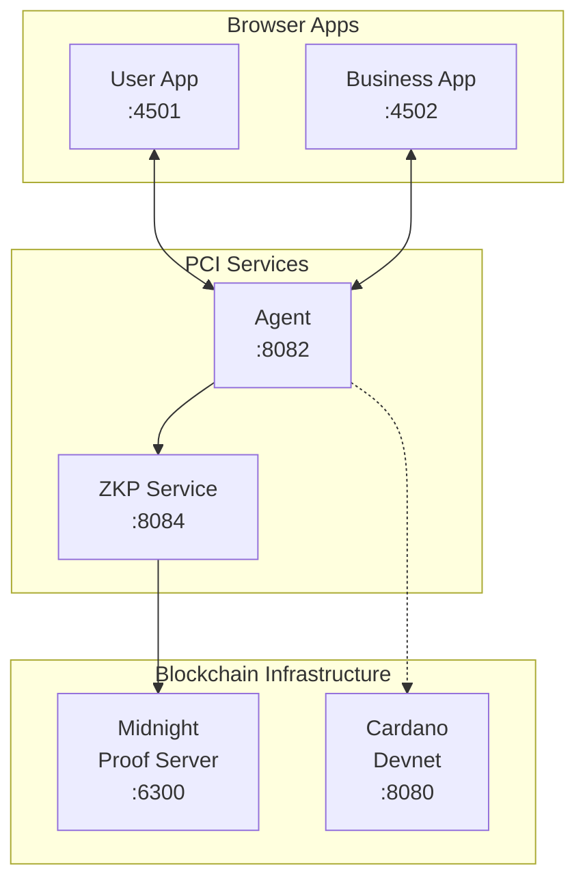

# PCI Demo

Interactive demonstration of Personal Context Infrastructure (PCI) showing privacy-preserving data sharing between users and businesses using zero-knowledge proofs.

## Overview

This demo showcases:

- **User App** - Request services, approve/deny verification requests, manage personal context
- **Business App** - Receive service requests, verify customer information without accessing raw data
- **Age Verification Flow** - Prove "user is >= 21" without revealing actual birth date

## Architecture



## Request Flow

The default flow starts in the User App with a service request; the Business
App responds with a verification requirement and completes the request once
verified:

```mermaid
sequenceDiagram
    participant U as User App
    participant A as Agent
    participant B as Business App
    participant Z as ZKP Service
    participant M as Midnight

    U->>A: POST /service-requests<br/>(e.g. "Purchase Alcohol")
    B->>A: GET /service-requests<br/>(polling)
    A-->>B: Pending service request
    B->>A: POST /requests<br/>(verify age >= 21,<br/>linked via service_request_id)
    U->>A: GET /requests<br/>(polling)
    A-->>U: Verification request
    U->>A: POST /requests/:id/approve<br/>(body: the ephemeral DID the proof is for,<br/>signed by its key over this request;<br/>private data comes from the context<br/>store, not the body)
    A->>Z: Generate ZK proof
    Z->>M: Midnight proof generation
    M-->>Z: ZK proof
    Z-->>A: Proof result
    A-->>U: Approved with proof
    B->>A: GET /service-requests<br/>(polling)
    A-->>B: Verified (ageOver: 21)
    B->>A: POST /service-requests/:id/complete
    A-->>B: Completed
```

With `VITE_ENABLE_SERVICE_FLOW=false` there is no service-request lifecycle:
the flow starts at the Business App's `POST /requests` and ends at the
verified result.

The approval call's body is optional and carries only `requester_did`, the
ephemeral DID the proof is for, with `signature`, that DID's key's signature
over the request id and the DID (`spal/did-approval/v1`). The agent refuses a
DID without a valid signature for that request, and stores the pair with the
response as `attestation` so the business can verify it too. The agent
sources the user's private data (e.g. birth date) from the encrypted context
store itself, so private data never travels in a plaintext HTTP body.

> **Note:** The service-request flow (`/services`, `/service-requests`,
> `/service-requests/:id/complete`) runs on the FastAPI agent under
> snake_case contract conventions and is enabled by default in both apps.
> Set the `VITE_ENABLE_SERVICE_FLOW=false` build arg (see
> `docker-compose.yml`) to fall back to the direct business-driven
> verification demo. There is no service catalogue: `GET /services` is the
> status aggregate.

## Prerequisites

Everything the demo needs is in this repository. `docker-compose.yml`
builds the agent, context store and ZKP service from the sibling
directories (`../agent`, `../context-store`, `../zkp`), so a single clone
is enough:

```bash
git clone https://github.com/freehold-earth/freehold.git
cd freehold/demo
```

### For Docker Compose (full stack)

Docker with Compose v2. No other checkouts are required.

### For Frontend Only (quick start)

If you only want to run the frontend apps against existing services:

```bash
pnpm install
pnpm dev
```

The apps depend on the workspace packages in this repository (for
example `identity/`) through `workspace:*`, so nothing has to be
installed from npm separately.

## Quick Start

### Development Mode (recommended)

Every service is served over TLS and the apps reach the agent and the
context store over `https://`, so first write the stack's CA and a
certificate per service (once; see `infra/README.md`), and trust the CA in
the browser (below):

```bash
(cd ../infra && ./scripts/certs.sh secrets context-store zkp agent cardano-api)
S=$PWD/../infra/secrets
```

```bash
# Start backend services first (in separate terminals):

# Terminal 1: Cardano devnet (if not running)
# See yaci-devkit setup; the agent reads it over https:// only, so put the
# compose stack's cardano-api proxy (or any TLS proxy) in front of it, or
# accept "unavailable" in the agent's status.

# Terminal 2: Context store
cd ../context-store && pnpm build && \
  TLS_CERT_FILE=$S/context-store.crt TLS_KEY_FILE=$S/context-store.key node dist/server.js

# Terminal 3: ZKP service
cd ../zkp && TLS_CERT_FILE=$S/zkp.crt TLS_KEY_FILE=$S/zkp.key npx tsx sdk/src/server.ts

# Terminal 4: Agent
cd ../agent && FREEHOLD_CA_FILE=$S/ca.crt \
  FREEHOLD_TLS_CERT_FILE=$S/agent.crt FREEHOLD_TLS_KEY_FILE=$S/agent.key \
  uv run python -m freehold_agent

# Terminal 5: Frontend apps
cd ../demo && pnpm dev
```

Access the apps:
- **User App:** http://localhost:4501
- **Business App:** http://localhost:4502

### Docker Compose

```bash
(cd ../infra && ./scripts/certs.sh secrets context-store zkp agent cardano-api)   # once
docker compose up --build

# User App:     http://localhost:4501
# Business App: http://localhost:4502
# Cardano Viewer: http://localhost:5173
```

The compose file mounts the certificates from `../infra/secrets` (or
`SECRETS_DIR`); the service names match the infra stack's, so the same files
serve both.

### Trust the stack's CA in the browser

The apps are plain pages, but they call the agent at `https://localhost:8082`
and the context store at `https://localhost:8081`, which serve certificates
from the stack's own CA. A browser that does not trust it refuses those calls
silently, so import `../infra/secrets/ca.crt` once. The CA is constrained to
the stack's names (`localhost`, `127.0.0.1` and the service names), so the
browser trusts it for those alone and never for a public site; a browser
profile kept for the demo narrows it further.

- **Chrome and Edge on Linux:** `certutil -d sql:$HOME/.pki/nssdb -A -t "C,," -n "Freehold stack CA" -i ../infra/secrets/ca.crt` (from `libnss3-tools`), then restart the browser
- **macOS (Safari, Chrome):** `security add-trusted-cert -d -r trustRoot -k ~/Library/Keychains/login.keychain-db ../infra/secrets/ca.crt`
- **Windows (Edge, Chrome):** `certutil -addstore -user Root ..\infra\secrets\ca.crt`
- **Firefox:** Settings, Privacy & Security, Certificates, View Certificates, Authorities, Import, and tick "Trust this CA to identify websites"

Remove it the same way when you rotate the CA.

### Deploy S-PAL Contracts (Optional)

Once the devnet is running, you can deploy S-PAL contracts:

```bash
# In a separate terminal, after docker compose is up:
cd ../contracts
pnpm install
pnpm deploy:devnet

# Run integration tests against devnet:
pnpm test:integration
```

This deploys the S-PAL validator to the local Yaci Cardano devnet. Currently the demo works without deployed contracts (verification is off-chain), but contract deployment enables future on-chain policy enforcement.

## Demo Walkthrough

### 1. Request a Service (User App)
1. Open http://localhost:4501 and unlock the vault. The app also hands the
   password to the agent (`POST /unlock`), which reads the same encrypted
   store server-side when it generates a proof; the "Agent Vault" indicator
   in the status bar turns green once it has
2. On the "Services" tab, click "Request" on "Purchase Alcohol" (21+)
3. The Business App (http://localhost:4502) picks up the request and
   auto-responds with an age-verification requirement

### 2. Approve Verification (User App)
1. See the "Verification Required" section under "My Requests"
2. Review what's being requested (age >= 21)
3. Click "Approve (Generate ZK Proof)" - no private data leaves the
   context store via the browser; the agent fetches it server-side
4. The approval issues a fresh ephemeral DID with a record your root DID
   signed; the record stays encrypted in the vault (under
   `identity/authorizations/`, which the agent never reads for a claim;
   the key is random, so the store never sees which DIDs are yours).
   The Identity tab lists these records and exports them, with the root
   DID, as a JSON file an auditor can verify with the identity library.
   The approval also sends that DID to the agent, signed by the DID's own
   key over this request. The agent checks the signature, then looks in
   the vault for the record your root signed for that DID and refuses the
   approval without one, so the proof the business receives is for a DID
   your root issued: the circuit commits to the DID it names, and the
   business app checks the signature against the request it created and
   says whether the DID's holder approved it

### 3. Proof Verified, Transaction Completed
1. The business auto-completes the verified request
2. Both apps' history sections show the completed transaction with the
   verification result - NOT the birth date

> With `VITE_ENABLE_SERVICE_FLOW=false`, the walkthrough instead starts from
> the Business App, which sends verification requests directly ("Request
> Verification"), and there is no service-request lifecycle.

## Service Status

The User App's status bar shows the encrypted context-store connection and
whether the agent holds the vault password ("Agent Vault"). The Agent,
Midnight ZKP, and Cardano indicators come from the agent's `/services`
status aggregate and appear in both apps whenever the service flow is enabled
(the default). With `VITE_ENABLE_SERVICE_FLOW=false` the Business App shows
no status bar.

The Business App's status bar also shows "Proof fees": the proof service's
DUST address and balance, relayed by the agent from the service's health
route. The business pays for its customers' proofs by designating its
NIGHT's DUST generation to that address (see `zkp/README.md`, "Sponsoring
proof fees"); each verified result then shows what its proof cost in specks
of DUST, paid from that capacity. The indicator is green only while DUST is
there to pay with, or while the service runs offline, where proofs make no
transaction and cost nothing (the default compose stack has no Midnight
network, so its proofs are offline). Whether the balance covers a given
proof's fee is only decided at proof time, when the service estimates the fee
and refuses the proof if the balance falls short. The customer pays nothing either way,
and the User App says so on each verification request.

The business acts on the address the proof service reports, so the agent's
ZKP service URL must point at a service the business trusts, over localhost
or TLS: whoever answers on that URL names where the sponsorship goes.

## Project Structure

```
demo/
├── apps/
│   ├── user-app/        # User-facing React app
│   └── business-app/    # Business-facing React app
├── packages/
│   └── shared/          # Shared types (demo-specific)
├── docker-compose.yml   # Full stack orchestration
└── pnpm-workspace.yaml  # Monorepo config
```

## Local Development with the Workspace Packages

The demo apps depend on the other packages in this repository through
`workspace:*`, so there is nothing to link or override. After changing a
package, rebuild it and the apps pick up the new build:

```bash
# From the repository root
pnpm --filter ./identity build
```

## Data Retention Enforcement

In this demo, the business app shows a disclaimer about "no retention" policies. In production, PCI enforces these policies through multiple mechanisms:

| Mechanism | Description | Status |
|-----------|-------------|--------|
| **Cryptographic Time-Locks** | Data encrypted with keys that automatically expire | Planned |
| **On-Chain Audit Trails** | All access events recorded on Cardano | Planned |
| **Threshold Decryption** | M-of-N community witnesses required for decryption | Planned |
| **Economic Incentives** | Businesses stake ADA collateral that can be slashed | Planned |
| **Graduated Trust** | New businesses have stricter requirements | Planned |

### How it works in production:

1. **Before sharing**: User checks business has sufficient stake on-chain
2. **During sharing**: Data is encrypted with time-locked keys, access recorded on Cardano
3. **After expiry**: Witnesses refuse to provide decryption shares
4. **Violation detected**: User submits claim to DAO, stake is slashed

See [PCI Technical Appendix - Data Retention Enforcement](https://github.com/freehold-earth/freehold/blob/main/docs/architecture/technical-appendix.md#data-retention-enforcement) for full details.

## Related Components

All in this repository:

- [`agent/`](../agent) - Coordination service (Python)
- [`zkp/`](../zkp) - ZKP service with Midnight integration
- [`contracts/`](../contracts) - Aiken smart contracts for Cardano
- [`context-store/`](../context-store) - Encrypted local data storage
- [`docs/`](../docs) - Documentation and specifications
- [`identity/`](../identity) - DID management library

## License

Apache 2.0
