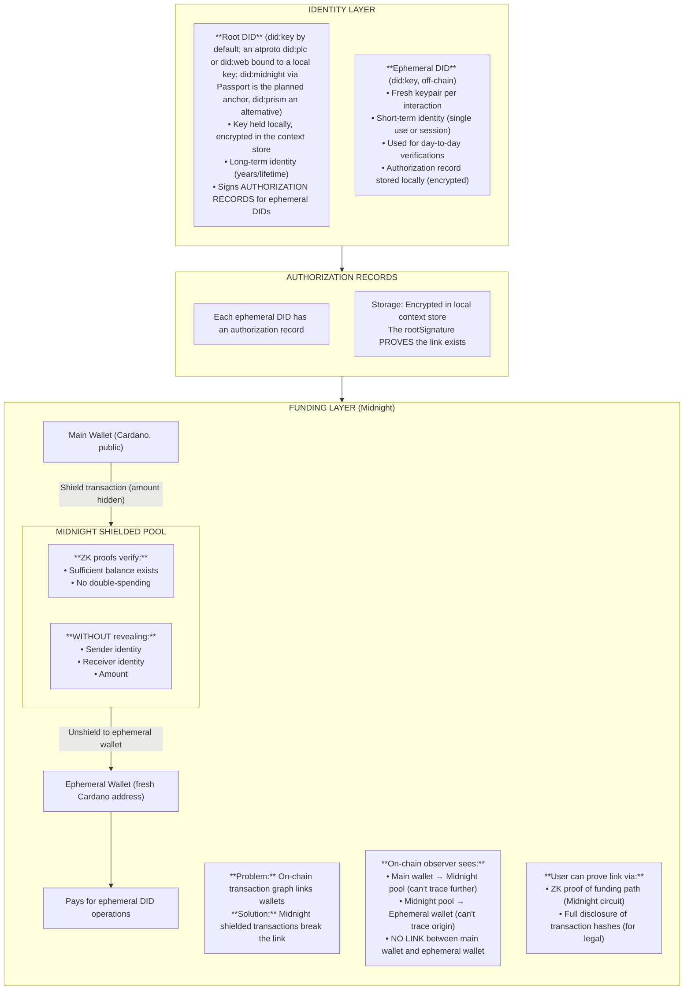

# Freehold Identity Privacy Model

**Status:** Approved
**Date:** 2025-12-16

## Core Principle

**Privacy is about controlling *who* can link, not preventing *all* linkage.**

The cryptographic link between Root DID and Ephemeral DIDs MUST exist, but only the user controls when and to whom it is revealed.

## Requirements

### Privacy Requirements
- Third parties CANNOT link ephemeral DIDs to each other
- Third parties CANNOT link ephemeral DIDs to root DID
- On-chain transaction analysis CANNOT reveal identity links
- Timing/metadata analysis CANNOT reveal identity links

### Provability Requirements
- User CAN prove any ephemeral DID belongs to their root DID
- User CAN prove funding source when legally required
- Proofs are cryptographically verifiable
- Authorization records provide audit trail

### Use Cases Requiring Proof
- Legal discovery ("prove you bought X")
- Copyright claims ("prove you created Y")
- Audit trails ("prove employment history")
- Insurance claims ("prove you were the policyholder")
- Inheritance ("prove these assets belong to estate")
- Service continuity ("prove you're same person who did action Y")

## Architecture



**Authorization Record Example:**

```json
{
  "ephemeralDid": "did:key:z6MkhaXgBZDvotDkL5257faiztiGiC2QtKLGpbnnEGta2doK",
  "rootDid": "did:key:z6MkfrQNKB1qGvBALocALKahRwPmZmnwyRRVfEsX8k4B7pNK",
  "purpose": "age_verification",
  "context": {
    "verificationType": "age_over_18",
    "verifierDid": "did:key:z6MkuAn3jnrCbkFYaKfrX7prLrDrEd8jjBt6vh2vDCNjWEuS",
    "policyHash": "0x..."
  },
  "timestamp": "2025-12-16T10:30:00Z",
  "expiresAt": "2025-12-16T11:30:00Z",
  "rootSignature": "0x..."
}
```

The JSON above is the stored form. `rootSignature` is made over the record's
canonical preimage, the `spal/did-authorization/v2` structure of the
[preimage encoding spec](../../spec/protocols/preimage-encoding.md): a domain
separator followed by every field with a length prefix, metadata as RFC 8785
canonical JSON. Any implementation can rebuild those bytes from the fields, and
moving a boundary between two fields can never yield a second record the same
signature verifies (ADR-007).

## Proof Scenarios

### Scenario 1: Full Disclosure (Legal/Audit)

When legally required to prove ownership:

```
Auditor: "Prove ephemeral DID X belongs to you"

User provides:
1. Root DID (did:key:z6Mk... — held locally, not on-chain)
2. Authorization Record for ephemeral DID X
3. Signs challenge with root private key

Auditor verifies:
✓ Authorization record signature matches root DID public key
✓ Challenge signature proves user controls root DID
✓ Root DID public key matches the one presented (with did:key the identifier is the key itself; with an atproto root the key is the one the account has published, see "External roots"; once an anchored method is adopted — did:midnight via Passport planned, did:prism as alternative — the public record replaces this step)

Result: Cryptographic proof that ephemeral DID X was authorized by user
```

### Scenario 2: ZK Proof (Privacy-Preserving)

When proving relationship without revealing root identity:

```
Service: "Prove you're the same person who did action Y"

User generates ZK proof (via Midnight):
"I know a root DID R such that:
 - R signed authorization for ephemeral DID A (action Y)
 - R signed authorization for ephemeral DID B (current request)
 WITHOUT revealing R"

Result: Proves continuity without revealing identity
```

### Scenario 3: Funding Proof

When required to prove funding source:

```
Investigator: "Prove where ephemeral wallet funds came from"

Option A - Full Disclosure:
User provides Midnight transaction hashes showing path

Option B - ZK Proof:
User generates proof: "Funds originated from wallet I control"
Without revealing which wallet
```

## Security Properties

### What Adversaries CANNOT Do

| Adversary | Cannot |
|-----------|--------|
| Business/Verifier | Link ephemeral DIDs to root or each other |
| Blockchain analyst | Trace funding from main wallet to ephemeral |
| Network observer | Correlate transactions by timing/IP |
| Colluding verifiers | Pool data to identify users |

### What Adversaries CAN Do (Acceptable)

| Adversary | Can |
|-----------|-----|
| Anyone | See that root DID exists on Cardano |
| Anyone | See VCs attached to root DID |
| Anyone | See that an atproto account has published a Freehold root key (external roots) |
| Verifier | Verify ephemeral DID signature is valid |
| Verifier | Verify ZK proof is valid |

### What User CAN Do

| User | Can |
|------|-----|
| Prove ownership | Of any ephemeral DID to any party |
| Prove funding | Source of any ephemeral wallet |
| Revoke | Ephemeral DID (mark as invalid) |
| Export | Full audit trail for legal discovery |

## External roots

A root DID is a `did:key` by default: the identifier is the key, so a record
is verified from its own fields. A root may instead be an atproto account,
`did:plc` or `did:web`, so that a member of a node that signs people in with
atproto gets Freehold ephemeral identities without a second credential.

An atproto account holder normally holds no signing key: the repository key
lives on the PDS, and so, usually, do the PLC rotation keys. The root key
therefore stays a Freehold-held Ed25519 key, and the account binds itself to
it by publishing the key as an `earth.freehold.rootKey` record in its own
repository (schema in `spec/schemas/lexicons/`). The PDS commits the record
on the holder's behalf, so its presence in the signed repository is the
holder's authorisation of that key. Authorization records then carry the
account as `rootDid`, and name the binding they were issued under as
`rootKeyId` (field 10 of `spal/did-authorization/v2`).

**Verification** resolves the DID document (plc.directory, or the did:web
well-known document), takes the PDS it names, fetches the binding record,
checks the binding is in force, and verifies the signature with the published
key. Resolution is injectable, so a verifier can work offline or against a
test fixture. Deleting or replacing the record revokes the binding: new
verifications of records issued under it fail. A verifier may opt in to
historical keys, resolving the binding a record names rather than the current
one; it then relies on the record's own timestamp to place the record inside
that binding's validity window, so a key rotated out because it was
compromised could still back-date records. The default is off, and a PDS
serves only the current record, so a superseded binding is available only
to a verifier that kept its own copy while it was current.

**What does not change.** Third parties still cannot link ephemeral DIDs to
each other or to the root; the binding carries no ephemeral DIDs and the
authorization records stay local. Nothing about an ephemeral DID says whether
its root is a `did:key` or an atproto account.

**What does change.**

1. The binding record is public. Anyone can see that the account has
   published a Freehold root key, which says the account holder uses Freehold.
   It says nothing about what the key has signed.
2. An authorization record the user chooses to disclose (Scenario 1) now
   names a public social identity rather than an opaque `did:key`. The
   decision to disclose remains the user's, but what is disclosed is more.
3. The verifier trusts the PDS the DID document names to serve the record as
   committed. Verifying the repository's commit proof against the account's
   atproto signing key is a possible hardening and is not done today.

Signing in to the node, and the OAuth session that lets the agent write the
binding, are the node's concern; this layer only takes a session as input.
See [ADR-009](../decisions/009-atproto-root-identity.md).

## Implementation Phases

### Phase 1: Authorization Records (tracked in #32)
- [x] AuthorizationRecord type definition
- [x] generateAuthorizedEphemeralDID() function
- [x] verifyAuthorizationRecord() function
- [x] Local encrypted storage of records: the demo user app keeps each record in the context store under `identity/authorizations/<random id>`, the DID only inside the encrypted value (#106)
- [x] Export functionality for audit: the Identity tab exports the records with the root DID as JSON (#106)
- [x] External roots: an atproto `did:plc` or `did:web` bound to a local key (#92)
- [x] Proofs bound to the ephemeral DID (#107): a human approval carries the DID the user's app issued, and the proof reveals it as `requesterDid`. Decided 2026-11-05: an autonomous approval binds nothing and the stored response says so (`requester_did: null`); the agent holds no signing key in this phase, and an agent-issued DID stays a later option. The DID is a self-reported public signal of the proof, not a value the circuit commits to, so a verifier reads which DID the proof names and must not take it as proof of possession; circuit-level binding is the ZKP SDK's follow-up

### Phase 2: Cardano-anchored DID method (implementation-deferred)
- [ ] Adopt did:midnight via Passport v2 for root-DID anchoring (ADR-008); keep did:prism as alternative
- [ ] Root DID anchoring on Cardano
- [ ] VC attachment to root DID
- [ ] DID resolution
- [ ] Key rotation mechanism

### Phase 3: Midnight Shielded Funding
- [ ] Midnight SDK integration
- [ ] Shield/unshield transaction flow
- [ ] Ephemeral wallet creation
- [ ] ZK funding proof generation

### Phase 4: ZK Identity Proofs
- [ ] "Same owner" proof circuit (Midnight Compact)
- [ ] Proof verification in S-PAL contracts
- [ ] Privacy-preserving service continuity

## Relationship to S-PAL

S-PAL policies can specify identity requirements:

```json
{
  "identity_linkage": {
    "ephemeral_required": true,
    "proof_of_root_allowed": false,
    "zk_continuity_allowed": true
  }
}
```

- `ephemeral_required`: Must use ephemeral DID, not root
- `proof_of_root_allowed`: Whether full disclosure is permitted
- `zk_continuity_allowed`: Whether ZK "same person" proofs accepted

## Open Questions

### 1. Authorization Record Storage
**Q:** Should authorization records be stored on-chain (encrypted) for recovery?
**Current answer:** No - local only. User responsible for backup.
**Future consideration:** Optional encrypted backup to user's cloud/community node.

### 2. Ephemeral DID Expiry
**Q:** Should ephemeral DIDs auto-expire?
**Current answer:** Optional `expiresAt` field. Default: no expiry.
**Consideration:** Expired DIDs still valid for historical proof, just can't be used for new signatures.

### 3. Root DID Recovery
**Q:** What if user loses root DID private key?
**Options:**
- Social recovery (threshold of trusted parties)
- Hardware security module backup
- If an anchored method (did:midnight via Passport, or did:prism) is later adopted, key rotation becomes possible on-chain — but original key loss remains permanent
**Current answer:** User responsibility. Document recovery options for Phase 2.
