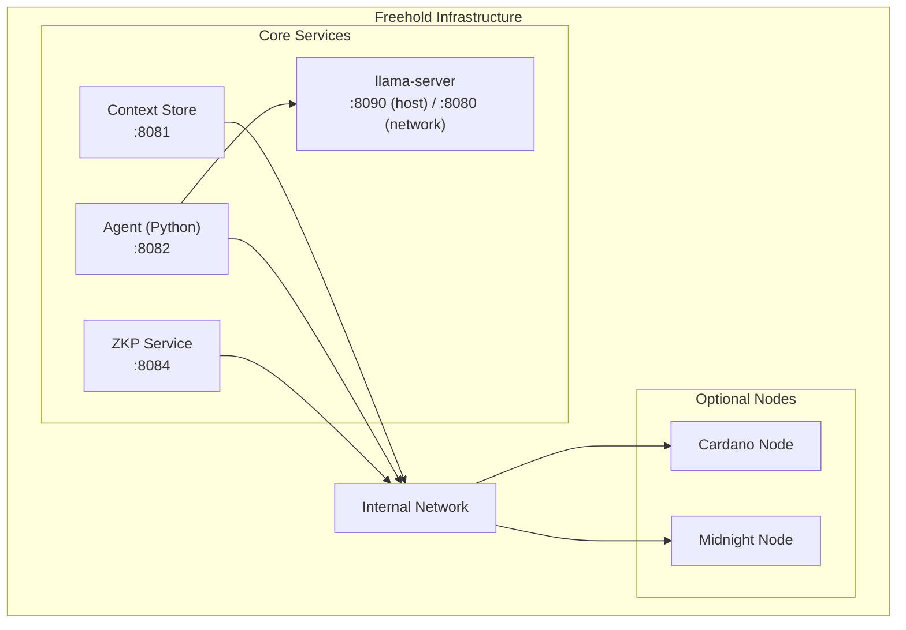

# Freehold Infrastructure

Infrastructure orchestration for Freehold development and testing.

This project integrates with the Midnight Network.

## Overview

This repo provides:

- **Full-stack orchestration** - Run all Freehold services together
- **Development environment** - Hot reload, debugging, local testing
- **Blockchain nodes** - Cardano and Midnight network configuration (Ledger 8.1.0)
- **Deployment scripts** - Contract deployment and setup utilities

## Quick Start

```bash
# First time setup: writes .env, and generates the stack's CA, a certificate
# per service and llama-server's API key. Compose refuses to start without
# them, so run this before anything else.
./scripts/setup.sh

# Start full stack
docker compose up

# Start with blockchain nodes (resource intensive)
docker compose --profile with-nodes up
```

## Architecture



## Services

Every port below is published on loopback only (`127.0.0.1`), since Docker-published ports bypass host firewalls such as ufw. Other services reach each other by service name on the compose network; put a gateway in front for anything that must be reachable from outside. Every link carries TLS, loopback included (see [TLS on every link](#tls-on-every-link)).

| Service | Port | Image | Description |
|---------|------|-------|-------------|
| context-store | 8081 | (built locally) | Layer 1: Encrypted vault API, over TLS |
| agent | 8082 | (built locally) | Layer 2: Personal agent API, over TLS |
| llama-server | 8090 | `ghcr.io/ggml-org/llama.cpp:server-b12063` | Layer 2: default LLM runtime, chat-completions API over one GGUF file, over TLS (ADR-006) |
| cardano-api | (none) | `nginx:1.29-alpine` | TLS in front of a plain-HTTP Cardano API (a Yaci devnet on the host by default) |
| zkp | 8084 | (built locally) | Layer 4: Zero-knowledge proof service, over TLS |
| midnight-proof-server | 6300 | `midnightntwrk/proof-server:8.1.0` | ZK proof generation (required for zkp) |
| cardano-node | (none) | `ghcr.io/intersectmbo/cardano-node:10.4.0` | Cardano preview testnet (optional) |
| midnight-node | 9944 | `midnightntwrk/midnight-node:1.0.1` | Midnight node (Ledger 8.1.0, optional) |
| midnight-indexer | 8088 | `midnightntwrk/indexer-standalone:4.3.3` | Midnight indexer with bundled SQLite storage (optional) |

## Profiles

```bash
# Core services only (lightweight)
docker compose up

# With Cardano preview testnet node
docker compose --profile cardano-testnet up

# With Midnight standalone (node + indexer for local testing)
docker compose --profile with-midnight up

# Full stack with all nodes
docker compose --profile with-nodes up

# Standalone mode (isolated Midnight environment)
docker compose --profile standalone up

# Development mode (hot reload)
docker compose -f docker-compose.yml -f docker-compose.dev.yml up
```

## Configuration

Copy the example env file and customize:

```bash
cp configs/example.env .env
```

Key settings:
- `CARDANO_NETWORK` - preview (default), preprod, or mainnet
- `MIDNIGHT_NETWORK` - preprod (default), preview, or mainnet
- `MIDNIGHT_INDEXER_URL` - Midnight indexer GraphQL endpoint (`/api/v4/graphql`)
- `MIDNIGHT_NODE_URL` - Midnight node RPC endpoint
- `INDEXER_SECRET` - Hex-encoded 32-byte secret required by the standalone indexer 4.x
- `INDEXER_BLOCKFROST_ID` - Blockfrost API key for the standalone indexer's SPO component (placeholder OK for local dev)
- `MODELS_DIR` - Host directory of GGUF model files, mounted into llama-server at `/models`
- `MODEL_FILE` - GGUF file inside `MODELS_DIR` that llama-server loads
- `LLM_CONTEXT_LENGTH` - Context window llama-server starts with (default 4096)
- `LLAMA_SERVER_PORT` - Host port for llama-server, bound to loopback only (default 8090; 8080 is the Cardano devnet API on the host)
- `COMPOSE_PROFILES` - `llm` (default) starts llama-server; empty leaves it out
- `FREEHOLD_LLM_API_KEY` - Bearer token llama-server requires; `setup.sh` generates `secrets/llama-api-key` for the server and writes the same value here
- `SECRETS_DIR` - Where the CA, every certificate and the API key live (default `./secrets`, relative to this directory; `setup.sh` reads it from the shell or from `.env`, as compose does)
- `FREEHOLD_LLM_BACKEND` - `http` (llama-server, default) or `ollama`; with `ollama`, run the daemon on the host behind a TLS proxy and set `FREEHOLD_LLM_URL` to the proxy's `https://` address. The agent refuses a plain `http://` model server
- `CORS_ORIGINS` (context store) - The browser origins the store answers, `https://` only and never a wildcard; the demo apps' origins by default. Set it on the `context-store` service when a different page is to read the store directly; a page from any other origin gets a 403 on every request; it is set together with the agent's `FREEHOLD_CORS_ORIGINS`, since both answer the same pages
- `CARDANO_UPSTREAM` / `FREEHOLD_CARDANO_URL` - The plain-HTTP Cardano API `cardano-api` puts TLS in front of (a Yaci devnet on the host by default), and the `https://` address the agent reads; see below
- `FREEHOLD_LLM_TIER` - `small` (default in compose) or `default`; names the model the agent asks for, which llama-server answers with whatever file it loaded
- `FREEHOLD_LLM_CUSTODY` / `FREEHOLD_ZKP_CUSTODY` - whose machine the model server and the proof service run on, on the S-PAL custody ladder (`device_only`, `owned_hardware`, `community_node`, `federated_operator`, `attested_enclave`, `any`). A rule's `custody` ceiling must admit the machine, or the agent refuses the ask or the proof. Unset means `owned_hardware`. A node run by someone the holder knows says `community_node`; an operator accountable through community governance says `federated_operator`. A policy that allows `community_node` admits the first and refuses the second, so the value has to be the honest one. The value is the deployment's own assertion
- `LOG_LEVEL` - debug, info, warn, error

### Midnight Network Endpoints

| Network | Indexer | Node | Faucet |
|---------|--------|------|--------|
| Preprod | `https://indexer.preprod.midnight.network/api/v4/graphql` | `https://rpc.preprod.midnight.network` | `https://faucet.preprod.midnight.network` |
| Preview | `https://indexer.preview.midnight.network/api/v4/graphql` | `https://rpc.preview.midnight.network` | - |
| Local | `http://127.0.0.1:8088/api/v4/graphql` | `http://127.0.0.1:9944` | - |

> Indexer 4.x still serves `/api/v3` as an alias for backwards compatibility;
> new work should target `/api/v4`. Verified against the Ledger 8.1.0 compatibility
> matrix at <https://docs.midnight.network/relnotes/support-matrix>.

## Scripts

| Script | Purpose |
|--------|---------|
| `setup.sh` | First-time setup, pull images, create volumes |
| `start.sh` | Start services with health checks |
| `stop.sh` | Graceful shutdown |
| `deploy-contracts.sh` | Deploy S-PAL contracts to testnet |
| `logs.sh` | Aggregate logs from all services |

## Development

### Building locally

```bash
# Build all services
docker compose build

# Build specific service
docker compose build agent
```

### Running tests

```bash
# Run integration tests
./scripts/test.sh

# Test specific service
docker compose run --rm agent pytest
```

### Viewing logs

```bash
# All services
docker compose logs -f

# Specific service
docker compose logs -f agent
```

## Directory Structure

```
infra/
├── docker-compose.yml          # Main orchestration
├── docker-compose.dev.yml      # Development overrides
├── services/
│   ├── cardano/                # Cardano node config
│   │   └── config/
│   └── midnight/               # Midnight node config
│       └── config/
├── scripts/
│   ├── setup.sh
│   ├── start.sh
│   ├── stop.sh
│   └── deploy-contracts.sh
└── configs/
    └── example.env
```

### LLM runtime

The stack runs `llama-server` by default (ADR-006): no outbound calls, one GGUF file, the chat-completions API on `https://llama-server:8080/v1` inside the network. Put a GGUF file in `MODELS_DIR` and name it in `MODEL_FILE`; `setup.sh` prints a download command for the default while `models/` holds no GGUF file. The agent waits for llama-server's health check, which passes once the model has loaded.

llama-server serves TLS with its certificate from the stack's CA (see [TLS on every link](#tls-on-every-link)). From the host, local tools trust the CA:

```bash
curl --cacert secrets/ca.crt -H "Authorization: Bearer $(cat secrets/llama-api-key)" https://127.0.0.1:8090/v1/models
```

llama-server is on the `llm` compose profile, which `example.env` enables by default through `COMPOSE_PROFILES=llm`. To use Ollama instead, run it on the host behind a TLS proxy, and set `COMPOSE_PROFILES=` (empty), `FREEHOLD_LLM_BACKEND=ollama` and `FREEHOLD_LLM_URL` to the proxy's `https://` address in `.env`; the agent then starts without llama-server. A proxy with a publicly trusted certificate needs nothing more, since the agent trusts the system store beside the stack's CA. A proxy with a private certificate needs that certificate inside the agent's container, named by `FREEHOLD_CA_FILE` (a path in the container): a bundle holding the stack's `ca.crt` and the proxy's certificate, mounted with a compose override. Do not append to `secrets/ca.crt` itself; `certs.sh` rewrites it when the CA is rotated and the appended certificate would go with it.

```yaml
# docker-compose.override.yml
services:
  agent:
    volumes:
      - /path/to/ca-bundle.crt:/run/ca-bundle.crt:ro
    environment:
      - FREEHOLD_CA_FILE=/run/ca-bundle.crt
```

### TLS on every link

Every link in the stack carries TLS, loopback or not: the vault password crosses the context store's, prompts and the bearer token the model server's, proofs the ZKP service's, and the browser's requests the agent's. No service falls back to plain HTTP when a certificate is missing; it refuses to start.

`setup.sh` (through `scripts/certs.sh`) writes the stack's own CA to `secrets/ca.crt` and, for each service (the demo stack's two apps included, so one CA serves both stacks), a certificate the CA signed, valid for the service's name, `localhost` and `127.0.0.1`, which is how compose and the host reach it. The CA is constrained to those names (a critical `nameConstraints` extension), so trusting it, in a browser or on a host, is trusting it for the stack alone: even with `ca.key` in hand nobody can sign for a public site. Compose mounts the files as secrets; each service serves with its own, and every client, the agent and each healthcheck included, trusts `ca.crt` and nothing else beyond the system store. To rotate one certificate, delete its two files, run `setup.sh` again and restart the stack, since a running container keeps the certificate it was started with; to rotate the CA, or to add a service name, delete `ca.key` and `ca.crt` and run `setup.sh` again, which re-issues every service's certificate under the new CA; then restart the stack and re-import `ca.crt` wherever a browser trusts it. A CA made before a name was added refuses the name, and `setup.sh` stops there saying so. The script touches nothing else in the directory.

The stack ships no Cardano API. `cardano-api` is an nginx proxy with a certificate from the CA that puts TLS in front of a plain-HTTP one, by default a Yaci devnet on the host at `http://host.docker.internal:8080`; the agent reads `https://cardano-api:8080`. Point `CARDANO_UPSTREAM` at another plain-HTTP API, or `FREEHOLD_CARDANO_URL` at any `https://` one. The hop from the proxy to the devnet is the one plaintext hop left, the same compromise as the TLS proxy in front of Ollama: it stays on the host, and a hosted API has TLS of its own.

For a browser to reach the agent (the demo apps do), it has to trust `secrets/ca.crt`; `demo/README.md` says how.

A `.env` written before this profile existed has no `COMPOSE_PROFILES` line, so llama-server never starts while the agent still expects it. Add `COMPOSE_PROFILES=llm` (or switch to Ollama as above); `setup.sh` warns when it finds such a file.

## Requirements

- Docker 24+
- Docker Compose v2
- 16GB RAM runs this stack as shipped: it loads a small GGUF (Phi-3-mini, about 2.3 GB) so it starts anywhere; the agent's own `small` Ollama tier is a different model, Phi-4-mini. A 27B-class model, the tier ADR-004 sizes a family node for, needs a 32 GB box; put its GGUF file in `MODELS_DIR` and name it in `MODEL_FILE`
- 50GB disk space for the local devnet's chain data; a mainnet relay's storage is sized in ADR-004

## License

Apache 2.0
