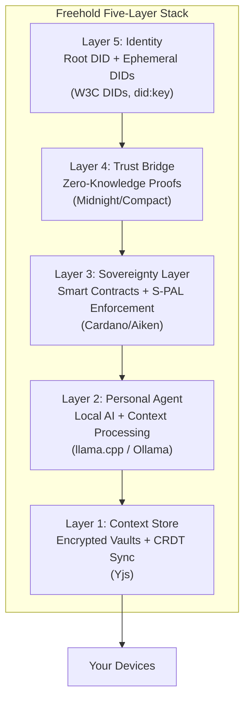
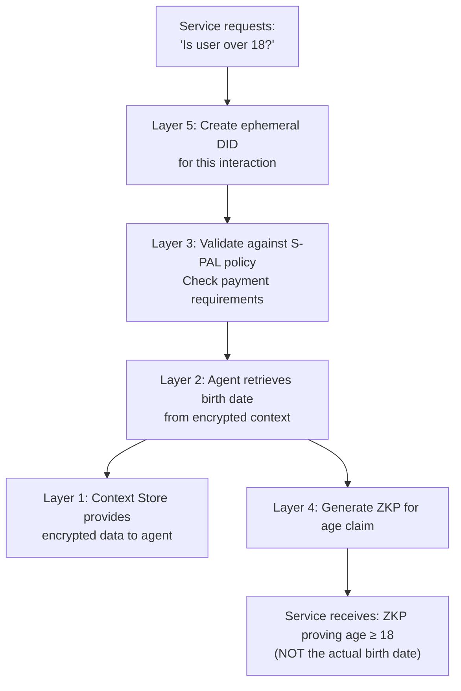

# Freehold Architecture Overview

## The Five-Layer Sovereign Stack

Freehold is built on five integrated layers that work together to provide data sovereignty with cryptographic guarantees.

## Layer 1: Context Store

**Purpose:** Secure, encrypted storage of all personal data

**Key Components:**
- Encrypted vaults (AES-256-GCM)
- CRDT-based sync across devices
- Vector embeddings for semantic search
- Local-first architecture

**Technology:** Yjs CRDTs, synced between a vault's devices through y-websocket (ADR-001)

**Data never leaves your control.** The Context Store is the foundation - all other layers build on top of locally-controlled data.

## Layer 2: Personal Agent

**Purpose:** AI processing without data leakage

**Key Components:**
- Local language models: a 27B-class default tier (Qwen3.6-27B) with a small tier (Phi-4-mini) for low-memory hosts
- Context retrieval and processing
- Policy validation
- Decision support

**Technology:** Python service; the llama.cpp family is the default runtime, Ollama is optional, and any OpenAI-compatible server can be configured (ADR-006)

**Deployment Options:**
- Device-native (laptop, desktop, home server)
- Phone: a thin client to an agent on hardware you own, or the native on-device track (ADR-006)
- Community node

**The agent thinks using your data but never exposes it.** External services interact with the agent, not your raw data.

## Layer 3: Sovereignty Layer

**Purpose:** Cryptographic enforcement of privacy rules

**Key Components:**
- S-PAL policy definitions
- Smart contract validators
- On-chain enforcement

**Technology:** Cardano blockchain; validators written in Aiken, with a TypeScript package for off-chain use (ADR-003)

**S-PAL policies are mathematically enforced.** If a service violates your policy, the transaction fails. It's not a suggestion - it's physics.

## Layer 4: Trust Bridge

**Purpose:** Prove facts without revealing data

**Key Components:**
- Zero-knowledge proof generation
- Selective disclosure
- Verification without revelation

**Technology:** Midnight (Compact), ZK circuits

**Services get verified facts, not data.** A proof answers the question that was asked and nothing else.

## Layer 5: Identity

**Purpose:** One identity you hold, many that you spend

**Key Components:**
- Root DID held locally (`did:key` today; `did:midnight` via Passport is the planned anchor, ADR-008)
- Ephemeral, single-use DIDs for each interaction
- Signed authorisation records linking an ephemeral DID to its root

**Technology:** W3C DIDs, TypeScript (`identity/`)

**Shadow profiles become impossible.** Every interaction uses a single-use identity, so services cannot correlate one visit with the next.

## Data Flow Example

## Deployment Models

### Individual

User runs all components on personal devices. Maximum sovereignty, requires technical knowledge.

### Family/Friend Node

Small group shares infrastructure. One technical person manages for extended group.

### Community Node

Organizations (libraries, co-ops, local businesses) run infrastructure for members. Professional management, local governance.

### Federation

Multiple communities interconnect for backup and resilience. Largest scale, delegated trust.

## Key Design Principles

1. **Local-First:** Data stays on user-controlled devices
2. **Cryptographic Guarantees:** Math enforces privacy, not policies
3. **Progressive Enhancement:** Works partially without full stack
4. **Community Operated:** Not dependent on any single entity
5. **Economically Sustainable:** Transparent costs, no data extraction

## Directory Map

| Directory | Layer | Purpose |
|-----------|-------|---------|
| spec | All | Specifications and schemas |
| context-store | 1 | Encrypted vault implementation |
| agent | 2 | Local AI agent |
| contracts | 3 | Smart contract validators |
| zkp | 4 | Zero-knowledge proof circuits |
| identity | 5 | DID management |
